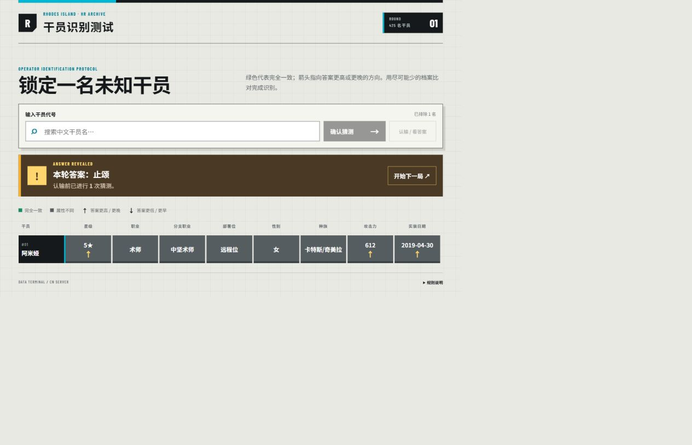

# 明日方舟猜干员

一个基于 React、TypeScript 与 Vite 的本地 Web 小游戏。输入中文干员名后，游戏会按星级、职业、分支、部署位、性别、种族、满级基础攻击力与国服实装日期逐项比对。绿色表示一致；`↑` / `↓` 表示答案的数值更高或更低、日期更晚或更早。

> 当前内置数据截止日期：**2026-09-04（明日方舟简中服）**，共收录 **429 名**正式实装的玩家可操作干员。

## 游戏截图

下图为 2026-08-30 拍摄的界面参考，展示了一次属性比对以及使用“认输 / 看答案”后的结果界面；截图中的干员数量对应当时的数据快照：



## 一键启动原版网页（Windows，推荐）

双击项目文件夹里的 **`启动游戏.bat`** 即可：它会自动切换到项目目录，首次启动时安装依赖，然后启动原版网页并自动打开浏览器。界面与手动执行 `npm install`、`npm run dev` 完全相同。后续启动会跳过已有依赖的安装。

- 电脑需要先安装下方要求的 Node.js（自带 npm）；只玩游戏不需要 Python。
- 首次安装依赖需要联网，启动后的游戏使用本地干员数据。
- 游玩时保留启动窗口，关闭该窗口就会停止服务。启动失败时窗口会保留错误提示。
- 分享时可以把项目文件夹压缩发给对方，建议排除 `node_modules`、`.git`、`.tmp-gamedata`、`dist` 和 `release`，保留源码、`public`、`package.json`、`package-lock.json` 及启动文件。对方**先解压**，安装 Node.js 后双击 `启动游戏.bat`，不用手动打开 PowerShell 或输入命令。
- 启动文件里的英文提示用于兼容 Windows 命令行编码，不影响游戏的中文界面。

## 可选：单文件离线版（无需安装）

在项目文件夹中双击 **`开始游戏.html`**，即可用浏览器直接游玩，不需要安装 Node.js、Python，也不需要启动本地服务或联网。建议使用较新的 Edge、Chrome 或 Firefox。

分享时发送 **`release/明日方舟猜干员-离线版.zip`** 即可。对方先解压，再双击里面的 `开始游戏.html`。也可以只发送这个 HTML 文件；无需发送整个项目、`node_modules` 或原始数据文件。请勿将根目录用于开发的 `index.html` 当作离线成品。

离线版内含生成时的干员数据快照。更新数据或修改游戏后，维护者需要重新生成离线版：

```bash
npm run build:portable
```

此命令先完成生产构建，再生成根目录的 `开始游戏.html` 和分享压缩包。仅生成过程需要开发环境（Node.js 与 Python）；收到成品的玩家只需要浏览器。离线成品使用系统字体，不会加载在线字体。生成文件不纳入 Git，因此从源码仓库下载后需要由维护者先打包，或直接向维护者获取离线压缩包。

## 开发与启动

要求 Node.js 20.19+（或 22.12+）和 Python 3.10+。

```bash
npm install
npm run dev
```

浏览器打开 Vite 输出的本地地址即可。游戏运行时只读取 `public/data/operators.json`，不依赖网络。

```bash
npm test
npm run build
```

## 数据来源与生成

数据不是手写的。`scripts/build_operator_data.py` 默认从以下公开来源下载原始数据并生成精简的本地文件：

- [ArknightsAssets/ArknightsGamedata](https://github.com/ArknightsAssets/ArknightsGamedata) 中文服数据：
  - `character_table.json`：名称、星级、职业、分支 ID、部署位与精英阶段基础属性。
  - `handbook_info_table.json`：玩家档案交集，以及基础档案中的性别、种族。
  - `uniequip_table.json`：`subProfDict` 中的中文分支职业名。
- [PRTS Wiki](https://prts.wiki/w/%E5%B9%B2%E5%91%98%E4%B8%8A%E7%BA%BF%E6%97%B6%E9%97%B4%E4%B8%80%E8%A7%88) 的 `char_obtain` Cargo 表：中文服首次上线时间。GameData 没有一张能够为所有寻访、活动、商店与赠送干员统一提供首次实装日期的表，因此仅这一字段使用 PRTS 补充；脚本不猜测缺失日期。

重新抓取最新数据：

```bash
npm run data:build
```

也可以使用已下载的原始文件，便于离线复现：

```bash
python scripts/build_operator_data.py --source-dir path/to/raw-data
```

当前快照的数据截止日期为 **2026-09-04**，共包含 **429 名**已在中文服正式实装的玩家可操作干员。筛选条件包括：角色 ID 为 `char_`、存在于 `handbookDict`、拥有干员编号与升级阶段、职业属于八大常规职业、部署位为近战位或远程位、并且 PRTS 上线日期不晚于生成日期。召唤物、敌人、陷阱、仅特殊模式可用角色以及预载但尚未实装的数据会被排除。异格干员在 GameData 中拥有独立 `charId`，因此自然作为不同干员保留。

## 满级攻击力口径

攻击力严格取 `character_table.json` 中该干员 `phases` 的最后一个元素，也就是其可达到的最高精英阶段；再在该阶段 `attributesKeyFrames` 中选择 `level` 最大的关键帧，读取 `data.atk`。

这就是“最高精英阶段 + 最高等级”的基础攻击力。生成过程不会读取 `favorKeyFrames`（信赖）、`potentialRanks`（潜能）、模组、技能或天赋，因此不包含任何额外加成。

## 项目结构

```text
src/components/                 游戏界面组件
src/game/                       类型、纯比较逻辑与测试
scripts/build_operator_data.py  数据下载、筛选与清洗脚本
public/data/operators.json      游戏直接读取的本地数据
docs/game-screenshot.png        README 使用的实际游戏截图
```

本项目为非官方同人项目。游戏资料与相关商标归其权利人所有；数据快照由社区项目整理。
